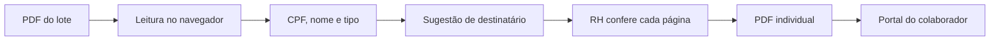
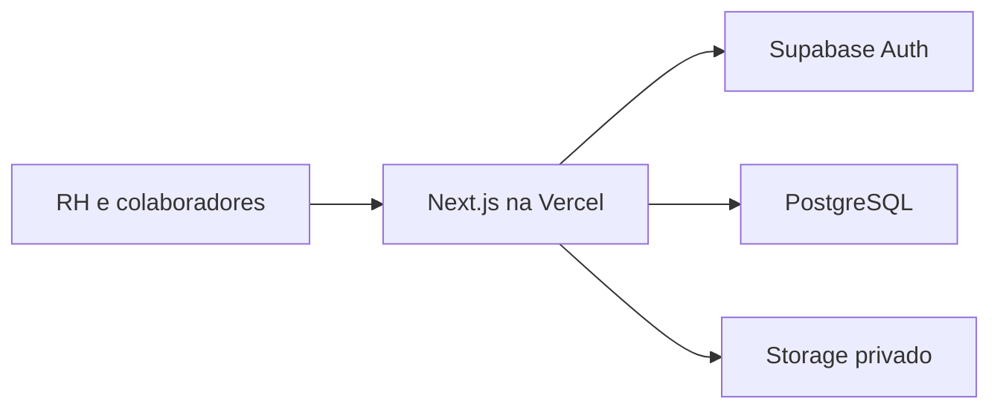

# Sistema de RH para uma malharia

Case de um sistema web que substituiu as planilhas do RH de uma malharia. Reúne colaboradores, férias, saúde ocupacional, documentos de pagamento, pagamentos de terceirizados e acesso do colaborador em um só lugar.

> [!NOTE]
> O código é privado porque o sistema é de uso interno. Este repositório mostra o problema, as decisões e os resultados técnicos.

**Meu papel:** desenvolvimento de ponta a ponta, do levantamento com o RH ao banco de dados, interface, testes e publicação. Usei agentes de IA como apoio no desenvolvimento e revisei as decisões técnicas.

**Status:** em uso pelo RH. O acesso dos colaboradores será liberado depois dos ajustes finais de segurança.

---

## O problema

O RH controlava as rotinas em planilhas separadas. Isso dificultava acompanhar prazos, manter um histórico confiável e entregar documentos a cada colaborador com segurança.

A rotina mais sensível era a de holerites e folhas de ponto. Esses documentos chegam em um único PDF, com uma página por pessoa. Uma página enviada para a pessoa errada expõe dados de outro colaborador.

---

## O que o sistema faz

| Área | Funcionalidades |
|---|---|
| Colaboradores | Cadastro, cargos, histórico e situação de acesso |
| Férias | Períodos aquisitivos, venda de até 1/3 e limite de períodos vencidos, conforme regras da CLT |
| Anotações | Saldo anual de dias, avisos de renovação, sobras e calendário responsivo |
| Saúde ocupacional | ASOs, prazos e atestados, com declarações em horas |
| Documentos | Separação de lotes em PDF, com conferência página por página e aviso de mês divergente |
| Terceirizados | Pagamentos mensais programados, avisos com antecedência escolhida pelo RH e histórico de pagamentos |
| Portal do colaborador | Acesso individual a holerites e folhas de ponto pelo celular |
| Acessos | Convite por e-mail, confirmação de CPF no primeiro acesso e perfis de permissão |
| Auditoria | Registro de entradas e de abertura de documentos, visível só para administradores |

---

## Destaque: separação de PDFs em lote

O PDF é lido no navegador. O sistema identifica o CPF e o nome em cada página, compara com o cadastro e sugere o destinatário.

**Decisões importantes:**

- **Conferência humana obrigatória:** nenhuma página é enviada sem confirmação do RH, mesmo quando CPF e nome conferem.
- **Validação do documento:** o sistema bloqueia holerite no fluxo de ponto e ponto no fluxo de holerite.
- **Avisos de divergência:** o RH vê quando faltam dados, quando o mês não aparece na página ou quando há duas páginas para a mesma pessoa.
- **Envio mínimo:** só as páginas confirmadas são salvas, cada uma como um arquivo individual.

---

## Arquitetura

| Camada | Tecnologias |
|---|---|
| Interface | Next.js, React, TypeScript, Tailwind CSS |
| Servidor | App Router, Server Components, Server Actions |
| Dados | PostgreSQL, Supabase, Row Level Security |
| Autenticação | Supabase Auth, convites e recuperação por e-mail |
| Documentos | Supabase Storage, pdf.js, pdf-lib |
| Migrações | Alembic e SQL versionado |
| Qualidade | Vitest, ESLint, TypeScript, GitHub Actions, gitleaks |
| Publicação | Vercel |

---

## Segurança e privacidade

O sistema trata dados pessoais e dados de saúde. Por isso, as permissões foram pensadas desde o início:

- A autorização fica também no banco, com Row Level Security, e não só na interface.
- Cada perfil acessa apenas o que precisa para sua função.
- Os documentos ficam em armazenamento privado e abrem por links temporários.
- Chaves administrativas ficam restritas ao servidor.
- Logs de acesso têm prazo de retenção definido.
- O backup é criptografado, e a restauração é testada em ambiente isolado.
- Testes automatizados verificam regras de acesso entre perfis.

---

## Desafios técnicos

- **PDFs reais são imprevisíveis:** o texto extraído pode vir quebrado, então a leitura aceita variações e trata CPF, CNPJ e nomes parecidos.
- **Regras trabalhistas no código:** férias e prazos de saúde ocupacional viraram regras testáveis, separadas da interface.
- **Uso no celular:** tabelas, calendário e formulários foram ajustados para telas pequenas.
- **Evolução segura do banco:** cada mudança passa por migração versionada, com ambiente local de dados fictícios.
- **Falsos registros de auditoria:** links de documentos não usam prefetch, para evitar registrar uma leitura que ninguém fez.
- **Pagamentos recorrentes sem agendador:** vencimentos e avisos são calculados a partir das regras cadastradas, inclusive em meses sem o dia 31.

---

## Qualidade

- Mais de 170 testes automatizados.
- Cobertura acima de 90% nas regras de negócio e ações do servidor.
- CI com testes, verificação de segredos e padrão de commits.
- Testes de acesso simulando visitantes e colaboradores tentando abrir dados de outras pessoas.

---

## O que aprendi

- Em sistemas de RH, permissão e rastreabilidade são requisitos de produto.
- Automação sensível funciona melhor quando apoia a decisão humana.
- Conversar com quem usa o sistema muda as regras mais do que qualquer especificação inicial.
- Testes tornam mudanças em regras legais muito mais seguras.

Desenvolvido por **[Vitor Boarreto](https://github.com/Boarreto)**.
